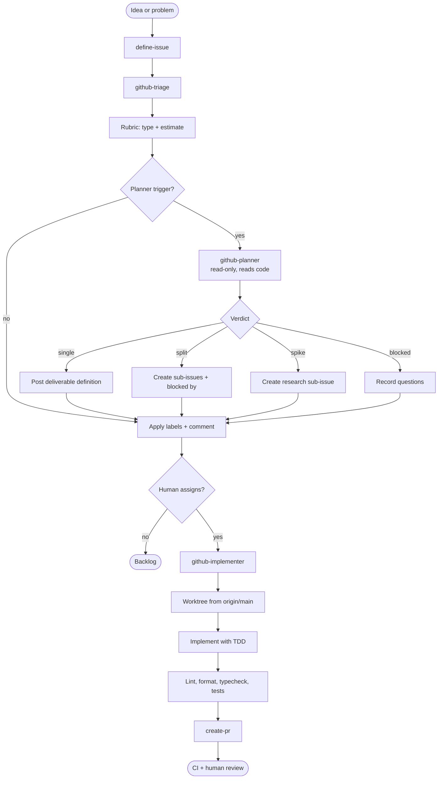
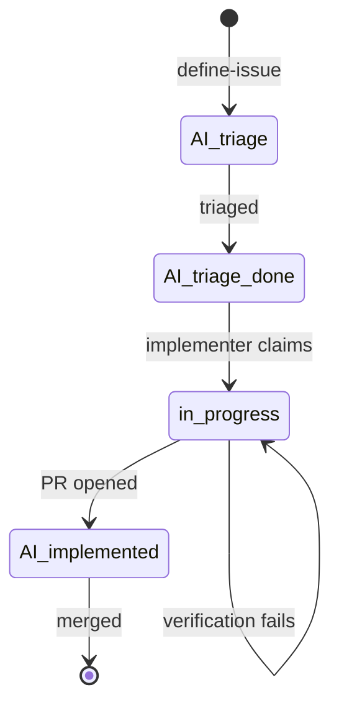

# GitHub issue flow

Five skills take an issue from a raw idea to a reviewed pull request. The flow is deliberately split into small phases with explicit human gates: an agent never starts work on an issue a human has not approved and assigned.

## Flow



## Skills

| Skill                                             | Owns                                                                               | Never does                                      |
| ------------------------------------------------- | ---------------------------------------------------------------------------------- | ----------------------------------------------- |
| [define-issue](define-issue/SKILL.md)             | The interview, the issue body and the `AI_triage` label plus assignee.             | Set `type:*`, `estimate:*` or split.            |
| [github-triage](github-triage/SKILL.md)           | The rubric estimate, `type:*` and `estimate:*`, sub-issues and the triage comment. | Write code or merge.                            |
| [github-planner](github-planner/SKILL.md)         | The deliverable definition and the split, spike or blocked verdict.                | Write labels, estimates, issues or files.       |
| [github-implementer](github-implementer/SKILL.md) | The branch, the worktree, the code, the PR and the `AI_implemented` label.         | Plan steps, merge or push to `main`.            |
| [github-workflow](github-workflow/SKILL.md)       | Running triage then the implementer in one cycle.                                  | Add, change or relax the rules of either phase. |

`github-workflow` is the only skill that runs unattended; it is meant for a recurring or scheduled run. The rest can be run on demand.

## The planner decision

Triage calls `github-planner` when the issue is large enough to need a decision: score 14 or more, any factor 4 or more, or Líneas 4 or more. The planner reads code, answers one question — is this one deliverable or several? — and returns `files` and `estimatedLines` as code evidence.

| Verdict   | Meaning                                                   | Triage does                                                     |
| --------- | --------------------------------------------------------- | --------------------------------------------------------------- |
| `single`  | One deliverable, even if it needs many steps.             | Posts `## Definición del entregable` as a comment.              |
| `split`   | Two to six independently shippable deliverables.          | Creates one sub-issue per deliverable, with `blocked by` links. |
| `spike`   | The approach is unknown and research must come first.     | Creates a research sub-issue and blocks the parent on it.       |
| `blocked` | The issue is ambiguous in a way that prevents a decision. | Triages the parent and records the open questions.              |

The planner is read-only. It never sets `type:*`, `estimate:*` or any label; triage keeps the estimate and remains the single writer of the label contract. Triage uses the planner's `files`, `estimatedLines` and `changes` to score `Líneas` and `Módulos`, marks `assumed` when a factor lacks code evidence, and raises the parent estimate with the sum of deliverable estimates on a `split`. Without the planner, triage falls back to `github-triage/assets/subtask-splitter-prompt.md`, which only splits at score 23 or more, or 500 or more estimated lines.

The implementer consumes the deliverable definition and decides the _how_ with TDD. It does not write a step plan: a plan written in triage would be stale by the time the issue is assigned, and duplicating it in the implementer was the problem this flow removes. It records a `Métricas:` line in the completion comment so triage can calibrate against actual diff size next time.

## Label lifecycle



`in_progress` is the `status:in-progress` label. Triage skips any issue with it, so two runs never pick the same issue.

## Label contract

Triage is the only writer of these labels. The implementer reads them and never infers the type from comments.

| Label                                                                              | Meaning                                          |
| ---------------------------------------------------------------------------------- | ------------------------------------------------ |
| `AI_triage`                                                                        | Candidate for triage, set by `define-issue`.     |
| `AI_triage_done`                                                                   | Triaged and ready, set by `github-triage`.       |
| `status:in-progress`                                                               | Claimed by the implementer; triage must skip it. |
| `status:blocked`                                                                   | Blocked; triage must skip it.                    |
| `AI_implemented`                                                                   | Implemented and linked to a PR.                  |
| `type:feature`, `type:docs`, `type:analysis`, `type:maintenance`, `type:tech-debt` | Task type; also selects the branch prefix.       |
| `estimate:1h` … `estimate:21h`                                                     | Original estimate from the rubric.               |

## Human gates

1. **Definition.** `define-issue` shows the draft and waits for approval before creating the issue.
2. **Authorization.** Triage unassigns every issue. The implementer only considers issues assigned to the token user, so a human must assign an `AI_triage_done` issue before any code is written.
3. **Review.** The implementer opens a PR and stops. CI and humans own review and merge; no skill merges.

## Usage

```sh
# invoke each skill from your harness

# define one issue, conversationally
define-issue

# triage the backlog, then implement one assigned issue
github-triage repo="owner/name"
github-implementer repo="owner/name"

# both phases in one cycle; schedule this with your harness (for example, every 30 minutes)
github-workflow repo="owner/name"
```

Install the whole flow:

```sh
npx skills add AlvaroVFon/skills \
  -s define-issue -s github-triage -s github-planner \
  -s github-implementer -s github-workflow
```

## Design notes

- The estimate is deterministic: task type plus six factors from `github-triage/references/estimation-scale.md`. The planner supplies code evidence; it never decides the label.
- The planner exists because the split decision needs code read, but the label and split authority stays in triage.
- `define-issue` verifies the premise against the code and always includes a `## Seguridad` section; a security dimension without an answer blocks the draft.
- The implementer never plans steps; the deliverable definition is the stable artifact, and `Métricas:` closes the calibration loop.
- The decision, alternatives and the data needed to validate it are in [`docs/decisions/0001-github-planner-split-decision.md`](../../docs/decisions/0001-github-planner-split-decision.md).
